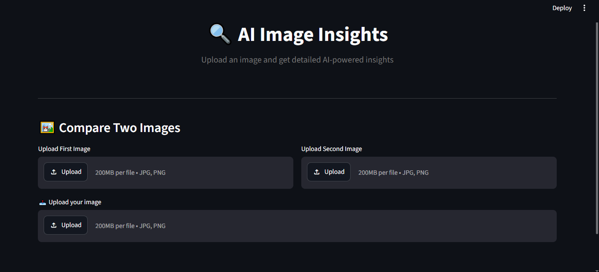

# AI-Powered Image Insights

An AI-powered Python application that analyzes images and generates useful insights using Google Gemini and Streamlit.

## Features

- AI-powered image descriptions
- Important object identification
- Useful insights and recommendations
- Chat with AI about an uploaded image
- Compare two images
- Downloadable PDF, TXT, and JSON reports
- Local analysis history and dashboard
- Retry handling for temporary API errors

## Technologies Used

- Python
- Streamlit
- Google Gemini API
- Pillow
- ReportLab
- python-dotenv

## Screenshots

### Home Page


### Uploaded Image


### Analysis Results


## Run Locally

1. Clone the repository.
2. Open the project folder in VS Code.
3. Create and activate a virtual environment:

   ```bash
   python -m venv venv
   venv\Scripts\activate
   ```

4. Install dependencies:

   ```bash
   python -m pip install -r requirements.txt
   ```

5. Create a `.env` file in the project root:

   ```text
   GEMINI_API_KEY=your_api_key_here
   ```

6. Start the app:

   ```bash
   python -m streamlit run app.py
   ```

## Security

Never upload your `.env` file or share your Gemini API key. The application stores analysis history locally in `data/history.json`.

## Purpose

This project demonstrates how Python and generative AI can be used to build an interactive image-analysis application with reporting and comparison features.